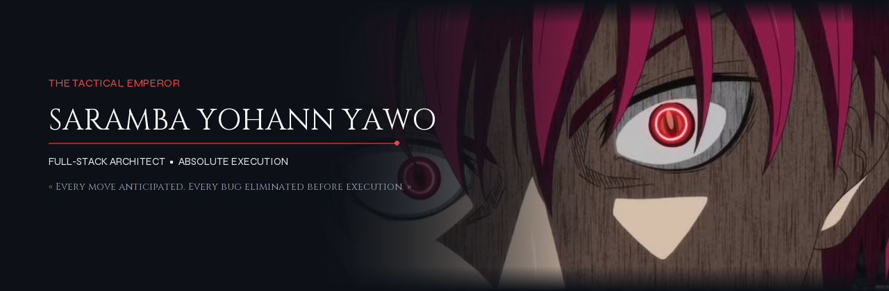

<!-- HERO BANNER UNIQUE : BLENDED EMPEROR BANNER (AKASHI SEIJŪRŌ × SARAMBA YOHANN YAWO) -->

<!-- TYPING DACTYLOGRAPHIÉ ÉPURÉ & OPTIMISÉ (PLEINE LARGEUR ET FLUIDE) -->

 

<!-- BADGES DE CONTACT ET COMPTEUR HARMONISÉS SUR UNE SEULE LIGNE -->

  
  &nbsp;
  
  &nbsp;
  
  &nbsp;
  
  &nbsp;
  

---

**<h3 align="left">Dans mon domaine, la défaite n'a jamais été une option. Mon œil perçoit chaque faille logique avant même son exécution, et mes lignes de code frappent avec l'impulsion foudroyante du Chidori. Tout ce que je conçois est pensé pour dominer, performer et durer.</h3>**

---

### ⚡ Mode Opératoire

- **Missions en cours :** [**Skoolis**](https://github.com/Sokka04/Skoolis) — Infrastructure moderne de gestion scolaire full-stack en TypeScript & micro-systèmes web.
- **Dernière réalisation :** [**Skoolis-Agri**](https://github.com/Sokka04/Skoolis-agri) — ERP de pilotage complet pour coopératives agricoles (PHP relationnel & MySQL).
- **Mindset :** Capacité d'analyse stratégique inspirée de *Sokka* combinée à l'exigence d'excellence absolue d'*Akashi Seijūrō*.
- **En perfectionnement :** Architectures distribuées, typage strict, performances de bases de données et interfaces haute fidélité.
- **Domaines clés :** TypeScript, React, PHP, Python, optimisation SQL et architectures web asynchrones.
- **Règle absolue :** *« Clean Code, Zero Overhead, Absolute Execution. »*

---

### Arsenal Technique

#### Langages & Frameworks

  
  
  
  
  
  
  
  

#### Systèmes, Bases de données & Outils

  
  
  
  
  

---

### Statistiques de Combat

  
  

  

---

### Projets Majeurs

| Projet | Objectif & Architecture | Technologies Clés |
| :--- | :--- | :--- |
| [**Skoolis**](https://github.com/Sokka04/Skoolis) | Solution d'envergure pensée pour digitaliser et fluidifier la scolarité du primaire au secondaire | `TypeScript` `Web Ecosystem` `Fullstack` |
| [**Skoolis-Agri**](https://github.com/Sokka04/Skoolis-agri) | Système de gestion intégré et automatisé pour coopératives du secteur agricole | `PHP` `MySQL` `Dashboard ERP` |
| [**Ecommerce-boutique**](https://github.com/Sokka04/Ecommerce-boutique) | Expérience e-commerce complète : catalogue produit, réactivité et tunnel d'achat | `Fullstack Architecture` `API` |
| [**Portfolio Perso**](https://github.com/Sokka04/Sokka04.github.io) | Hub interactif et vitrine de mes réalisations techniques | `HTML5` `CSS3` `JavaScript` |

---

  

    <b>« Lower your head. Those who oppose my code will not be allowed to look down on it. »</b> 
    Saramba Yohann YAWO (Sokka04) · Lomé, Togo
  

