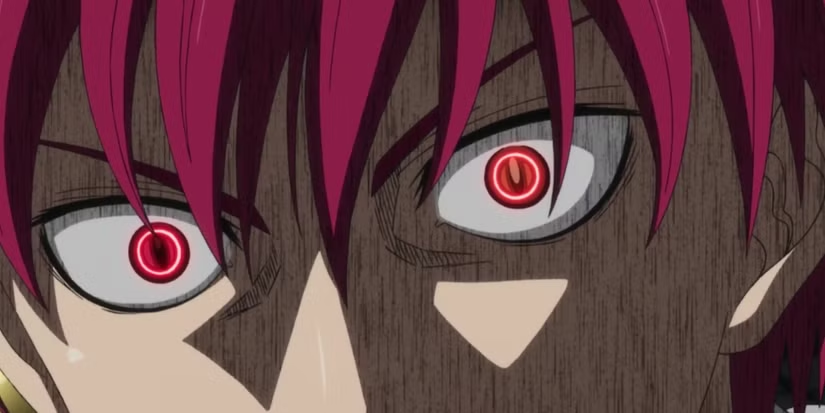

<!-- HERO BANNER : SEIJURO AKASHI (EMPEROR DOMAIN) -->

  

<!-- BANNIÈRE HEADER AMÉLIORÉE : ONDE D'ÉNERGIE CRIMSON & CHIDORI (THÈME AKASHI / ONYX / AMATERASU) -->

<!-- TEXTE ANIMÉ TYPING DACTYLOGRAPHIÉ -->

 

<!-- BADGES DE CONTACT & STATUT (PALETTE SOMBRE & CRIMSON) -->

  
  
  
  

<!-- COMPTEUR DE VISITEURS DU DOMAINE -->

  

<!-- TITRE TOC DE STYLE AKSHAY YADAV (Aks20997) -->

  <ul align="center" style="list-style: none">
    

      <h2>⚡ THE TACTICAL EMPEROR'S SANCTUM ⚡</h2>
    

  </ul>

**<h3 align="left">🚀 Dans mon domaine, la défaite n'a jamais été une option. Mon œil perçoit chaque faille logique avant même son exécution, et mes lignes de code frappent avec l'impulsion foudroyante du Chidori. Tout ce que je conçois est architecturé pour dominer, performer et durer.</h3>**

---

### ⚡ Rapid Fire & Mode Opératoire

- 💼 **Missions en cours :** [**Skoolis**](https://github.com/Sokka04/Skoolis) (Infrastructure moderne de gestion scolaire full-stack en TypeScript) & micro-systèmes web réactifs.
- 🌾 **Dernier haut fait de guerre :** [**Skoolis-Agri**](https://github.com/Sokka04/Skoolis-agri), un ERP de pilotage complet pour coopératives agricoles (PHP relationnel & MySQL).
- 🧠 **Tactical Mindset :** Capacité d'analyse stratégique inspirée de *Sokka* combinée à l'exigence d'excellence absolue et d'invincibilité d'*Akashi Seijuro*.
- 🌱 **En perfectionnement continu :** Architectures distribuées, typage ultra-strict, scalabilité de base de données & micro-interactions UI.
- 💬 **Interrogez-moi sur :** TypeScript, React, PHP, Python, optimisation SQL, modélisation de données & architectures backend asynchrones.
- ⚡ **Fun fact :** *« Depuis que je gagne toujours, j'ai forcément toujours raison. »*
- 🎯 **Règle absolue :** *« Clean Code, Zero Overhead, Absolute Execution. »*

---

### ⚔️ L'Arsenal Technique (Jutsu & Masteries)

#### 🌀 Langages & Frameworks

  
  
  
  
  
  
  
  

#### 🔮 Systèmes, Bases de Données & Outils

  
  
  
  
  

---

### 📊 Radar de Combat & Statistiques

  <!-- STATISTIQUES GLOBALES (Palette Dark Onyx / Crimson Amaterasu) -->
  
  
  <!-- TOP LANGAGES -->
  

  <!-- SÉRIE DE COMMITS (STREAK STATS HARMONISÉ CRIMSON / ONYX) -->
  

---

### 🏆 Projets Majeurs (Missions de Rang S)

| Mission / Dépôt | Objectif & Architecture | Technologies Clés |
| :--- | :--- | :--- |
| 🎓 [**Skoolis**](https://github.com/Sokka04/Skoolis) | Solution d'envergure pensée pour digitaliser et fluidifier la scolarité du primaire au secondaire | `TypeScript` `Web Ecosystem` `Fullstack` |
| 🌾 [**Skoolis-Agri**](https://github.com/Sokka04/Skoolis-agri) | Système de gestion intégré et automatisé pour coopératives du secteur agricole | `PHP` `MySQL` `Dashboard ERP` |
| 🛍️ [**Ecommerce-boutique**](https://github.com/Sokka04/Ecommerce-boutique) | Expérience e-commerce complète : catalogue produit, réactivité et tunnel d'achat | `Fullstack Architecture` `API` |
| 🌐 [**Portfolio Perso**](https://github.com/Sokka04/Sokka04.github.io) | Hub interactif et vitrine de mes réalisations techniques | `HTML5` `CSS3` `JavaScript` |

---

<!-- SECTION FOOTER VAGUE ÉNERGÉTIQUE ET CITATION EMPEREUR -->

  

    <b>« Lower your head. Those who oppose my code will not be allowed to look down on it. »</b> 
    Conçu par <b>Yohann YAWO (Sokka04)</b> • Lomé, Togo 🇹🇬
  

  

